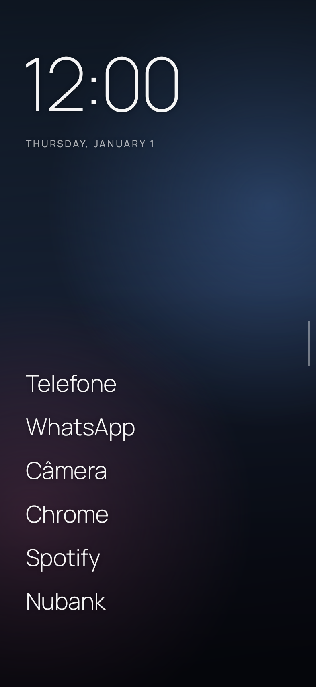
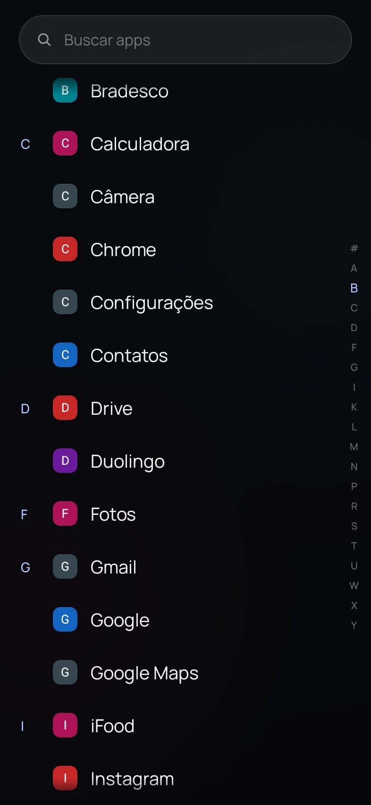
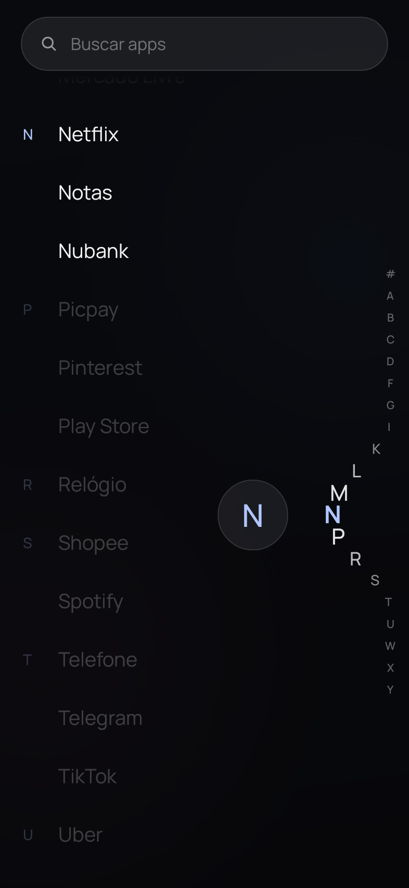
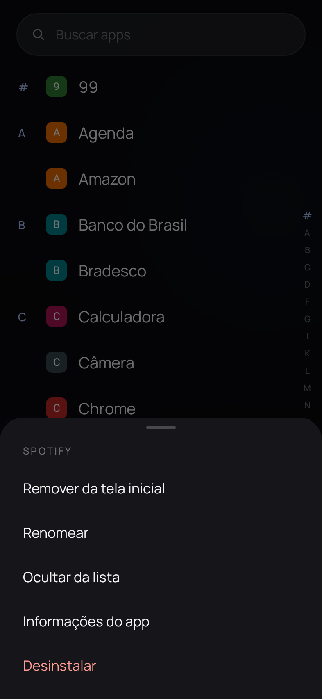

# Lista — launcher minimalista para Android

Tela inicial em forma de lista, sem ícones: só o relógio, a data e os apps que você escolher.

**APK pronto:** [`apk/Lista-Launcher-1.3.apk`](apk/Lista-Launcher-1.3.apk) (~140 KB, Android 8.0 ou mais novo)

| Tela inicial | Arrastando na tela | Arrastando na borda | Menu do app |
|---|---|---|---|
|  |  |  |  |

## Como instalar

1. Baixe o APK no celular e abra o arquivo.
2. Se pedir, permita "instalar apps desconhecidos" para o navegador ou gerenciador de arquivos.
3. Abra o **Lista** e toque no aviso "Toque para usar o Lista como tela inicial"
   (ou vá em Configurações → Apps → Apps padrão → App de tela inicial).

## Como usar

| Onde | Gesto | O que faz |
|---|---|---|
| Tela inicial | arrastar para cima em qualquer lugar | a lista aparece e segue o dedo (sobe e desce); ao soltar, continua deslizando |
| Tela inicial | deslizar para cima começando na parte de baixo (abaixo dos apps fixados) | mostra os apps abertos (precisa ativar o Lista em Acessibilidade uma vez) |
| Tela inicial | arrastar para baixo | abre a busca com o teclado (ou as notificações, se preferir, nas opções) |
| Tela inicial | tocar e arrastar na borda direita (tracinho) | pula direto pelas letras, A a Z |
| Tela inicial | tocar e segurar um espaço vazio | opções (borda direita, deslizar para baixo, teclado, apps ocultos, papel de parede) |
| Tela inicial | tocar no relógio / na data | abre alarmes / agenda |
| Tela inicial | tocar e segurar um app fixado | mover, renomear, remover, atalhos do app |
| Lista | digitar na busca | filtra na hora (ignora acentos, aceita iniciais: "gm" → Google Maps) |
| Lista | Enter no teclado | abre o primeiro resultado (ou busca na web se nada for encontrado) |
| Lista | arrastar o dedo na barra de letras à direita | rola acompanhando o dedo, letra por letra |
| Lista | deslizar para baixo no topo / voltar | volta para a tela inicial |
| Lista | tocar e segurar um app | fixar na tela inicial, renomear, ocultar, informações, desinstalar |

**Apps abertos:** o Android não deixa um launcher de terceiros abrir a tela de apps recentes
diretamente. O Lista usa um serviço de Acessibilidade que só aciona a ação "Recentes" do sistema
(não lê nada da tela). Para ativar: Configurações → Acessibilidade → Apps instalados → Lista. No
Android 13+, se aparecer "configuração restrita": Configurações → Apps → Lista → três pontinhos →
Permitir configurações restritas, e depois ativar.

Na primeira vez, Telefone, WhatsApp, Mensagens, Câmera e Navegador já aparecem fixados (se estiverem
instalados). A tela inicial comporta até 8 apps.

## Compilar

Requer JDK 17+ e o Android SDK (platform 36).

```bash
echo "sdk.dir=/caminho/para/android-sdk" > local.properties
./gradlew testReleaseUnitTest assembleRelease
# APK em app/build/outputs/apk/release/app-release.apk
```

O app é Kotlin puro, sem bibliotecas externas. A fonte é a [Manrope](https://github.com/sharanda/manrope)
(licença SIL OFL, ver `FONT-LICENSE-OFL.txt`).

Capturas de tela sem emulador (Robolectric):

```bash
SCREENSHOT_DIR=/tmp/telas ./gradlew testReleaseUnitTest -Pscreenshots
```

`app/debug.keystore` é uma chave de **depuração** (senha `android`) versionada de propósito, para que
qualquer build tenha a mesma assinatura e atualize o app já instalado. Não serve para publicar na
Play Store: para isso, crie uma chave própria e mantenha-a fora do repositório.
